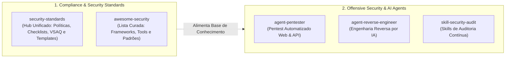

# SecurityStandards Organization

Bem-vindo à organização **SecurityStandards**. Nosso foco é estabelecer padrões, políticas e ferramentas de auditoria e agentes inteligentes para segurança cibernética e conformidade.

---

## 🏛️ Visão Geral & Ecossistemas

A organização estrutura seus repositórios e iniciativas em dois grandes pilares:

---

## 📂 Repositórios em Destaque

### 🌟 Hub Canônico e Curadoria
* [**security-standards**](https://github.com/SecurityStandards/security-standards): **Repositório Unificado** contendo políticas mapeadas (NIST, HIPAA, PCI DSS, CIS), checklists operacionais (CTO e DevOps), aplicação de questionários de fornecedores (Google VSAQ) e templates de páginas de segurança.
* [**awesome-security**](https://github.com/SecurityStandards/awesome-security): Lista curada definitiva no padrão Awesome cobrindo frameworks, ferramentas de DevSecOps, políticas, auditoria e agentes de IA.

### 🤖 Inteligência Artificial & Segurança Ofensiva
* [**agent-pentester**](https://github.com/SecurityStandards/agent-pentester): Agente autônomo de pentest focado em análise de código-fonte, mapeamento de vetores de ataque e validação de exploits em aplicações web e APIs.
* [**agent-reverse-engineer**](https://github.com/SecurityStandards/agent-reverse-engineer): Agente autônomo para engenharia reversa de comportamento de aplicações e binários nativos.
* [**skill-security-audit**](https://github.com/SecurityStandards/skill-security-audit): Skill para agentes de codificação conduzirem auditorias de segurança em fases com achados estruturados e verificáveis.

---

## 🤝 Diretrizes da Comunidade & Contribuição

* **Segurança Primeiro**: Antes de reportar qualquer falha de segurança pública, consulte nossa política de [SECURITY.md](SECURITY.md).
* **Spec-Driven Development (SDD)**: Todas as mudanças arquiteturais e unificações de repositórios seguem especificações formais.
* Para propor melhorias ou novas ferramentas, abra uma issue ou discussão na organização.
