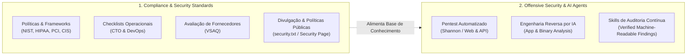

# SecurityStandards Organization

Bem-vindo à organização **SecurityStandards**. Nosso foco é estabelecer padrões, políticas e ferramentas de auditoria e agentes inteligentes para segurança cibernética e conformidade.

---

## 🏛️ Visão Geral & Ecossistemas

A organização estrutura seus repositórios e iniciativas em dois grandes pilares:

---

## 📂 Mapa de Repositórios

### 🛡️ Padrões, Políticas e Governança
* [**security-policy-templates**](https://github.com/SecurityStandards/security-policy-templates): Políticas, padrões e procedimentos de controle mapeados para HIPAA, NIST CSF, PCI DSS, FedRAMP e CIS Controls.
* [**CTOSecurityChecklist**](https://github.com/SecurityStandards/CTOSecurityChecklist): Checklist prático de segurança para lideranças técnicas e CTOs de SaaS.
* [**DevOpsSecurityChecklist**](https://github.com/SecurityStandards/DevOpsSecurityChecklist): Práticas essenciais de segurança para infraestrutura, pipelines CI/CD e operações em nuvem.
* [**security-page**](https://github.com/SecurityStandards/security-page): Template pronto para implementação de páginas públicas de segurança e programas de divulgação de vulnerabilidades.
* [**vsaq**](https://github.com/SecurityStandards/vsaq): Questionário interativo de avaliação de segurança de parceiros e terceiros (*Vendor Security Assessment Questionnaire*).

### 🤖 Inteligência Artificial & Segurança Ofensiva
* [**agent-pentester**](https://github.com/SecurityStandards/agent-pentester): Agente autônomo de pentest focado em análise de código-fonte, mapeamento de vetores de ataque e validação de exploits em aplicações web e APIs.
* [**agent-reverse-engineer**](https://github.com/SecurityStandards/agent-reverse-engineer): Agente autônomo para engenharia reversa de comportamento de aplicações e binários nativos.
* [**skill-security-audit**](https://github.com/SecurityStandards/skill-security-audit): Skill para agentes de codificação conduzirem auditorias de segurança em fases com achados estruturados e verificáveis.

---

## 🤝 Diretrizes da Comunidade & Contribuição

* **Segurança Primeiro**: Antes de reportar qualquer falha de segurança pública, consulte nossa política de [SECURITY.md](SECURITY.md).
* **Spec-Driven Development (SDD)**: Todas as mudanças arquiteturais e unificações de repositórios seguem especificações formais.
* Para propor melhorias ou novas ferramentas, abra uma issue ou discussão na organização.
